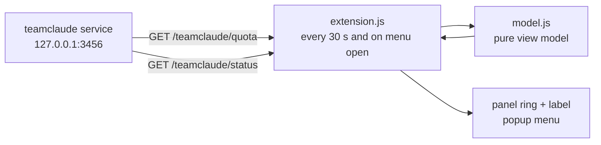

# TeamClaude Gauge

GNOME Shell 49 panel indicator for a local [teamclaude](https://github.com/KarpelesLab/teamclaude) proxy. It shows where the account fleet stands on the 5h window, the weekly window and the Fable weekly cap.

## Panel

A ring plus one short label. The first matching rule wins.

| # | Fleet state | Label | Ring |
|---|---|---|---|
| 1 | Proxy unreachable | `TC off` | grey |
| 2 | A bucket is capped on every account | `Fable 99% · back in 3h48` | red, full |
| 3 | Top bucket at 70% or more | `Fable 90% · 7d 51%` | amber or red |
| 4 | Otherwise | `7d 60%` | green |

- Capped: no active account is under teamclaude's switch threshold (0.99 by default, per bucket when configured).
- Block order: `7d`, then `5h`, then `Fable`. A capped 7d or 5h window blocks every model.
- Percentages are fleet values, weighted by plan tier, rounded down.

## Menu

| Section | Content |
|---|---|
| Header | Account count, current account |
| Buckets | Bar, percent, next reset (or `back in ...` when capped) |
| Next resets | At 90% or more: the 3 soonest account resets of that bucket, with the fleet share each one frees |
| Accounts | Collapsed list: 5h, 7d, Fable per account; current in bold, inactive dimmed |
| Footer | Open dashboard, age of teamclaude's last quota probe |

## Data flow



Both calls are local and read-only. The extension sends nothing anywhere else.

## Install

Requires GNOME Shell 49 and the teamclaude service (`teamclaude service install`).

```bash
./install.sh   # symlinks extension/ and enables it
```

On Wayland, log out and back in to load it.

## Develop

| Command | What it checks |
|---|---|
| `npm test` | `model.js` unit tests, plus a read-only smoke test against the running proxy (skips when it is down) |
| `tests/headless.sh` | Loads the extension in a throwaway headless Shell, exit 0 when ACTIVE |
| `tests/headless.sh DIR` | Same, and saves panel and menu screenshots (dark and light) to `DIR` |

The Shell reads extension code at login only. `tests/headless.sh DIR` shows a change without a re-login.

| Path | Role |
|---|---|
| `extension/model.js` | Every display decision; no GNOME imports |
| `extension/extension.js` | Polling, menu, rendering |
| `extension/ring.js` | Panel ring (Cairo) |
| `extension/stylesheet.css` | Level colors and layout |

## Version history

| Version | Date | Change |
|---|---|---|
| 1 | 2026-10-23 | First release |

Last updated: 2026-10-23
