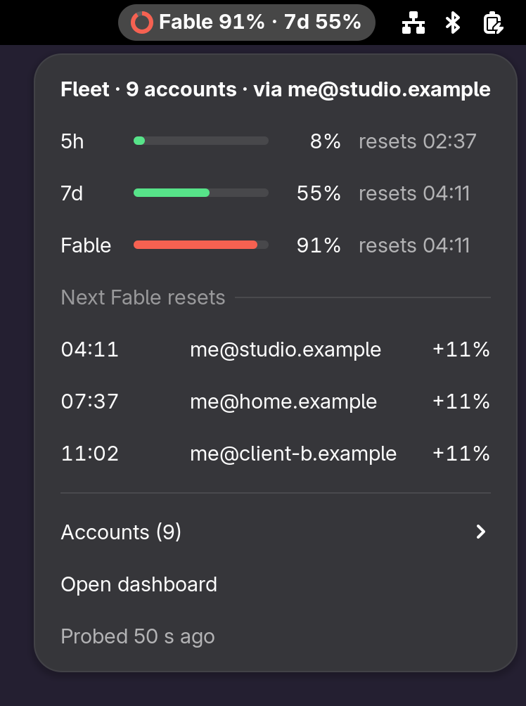
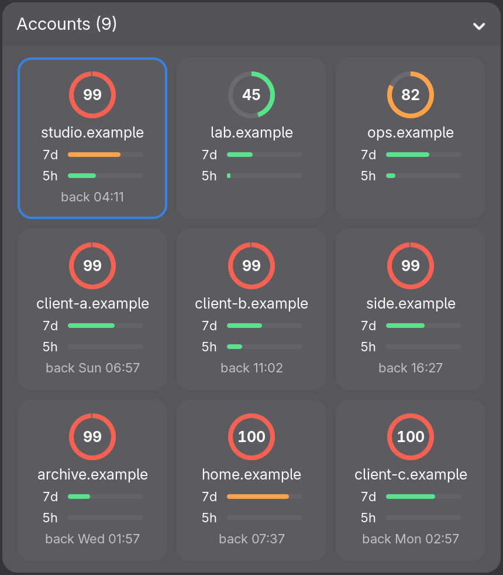
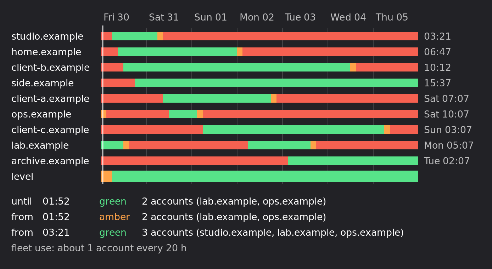
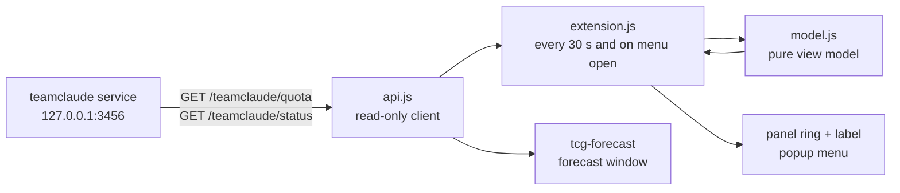
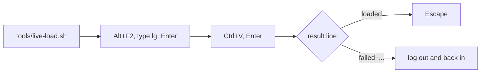

# TeamClaude Gauge

GNOME Shell 49 panel indicator for a local [teamclaude](https://github.com/KarpelesLab/teamclaude) proxy. It shows where the account fleet stands on the 5h window, the weekly window and the Fable weekly cap, and when Fable comes back.

<p align="center">
  
  
</p>
<p align="center"><sub>A fictional fleet, from <code>tests/demo.js</code></sub></p>

## Panel

A ring plus one short label. The first matching rule wins.

| # | Fleet state | Label | Ring |
|---|---|---|---|
| 1 | Proxy unreachable | `TC off` | grey |
| 2 | A bucket is capped on every account | `Fable 99% · back in 3h48` | red, full |
| 3 | Top bucket at 70% or more | `Fable 90% · 7d 51%` | amber or red |
| 4 | Otherwise | `7d 60%` | green |

- Capped: no active account is under teamclaude's switch threshold (0.99 by default, per bucket when configured).
- Block order: `7d`, then `5h`, then `Fable`. A capped 7d or 5h window blocks every model.
- Percentages are fleet values, weighted by plan tier, rounded down.

## Menu

| Section | Content |
|---|---|
| Header | Account count, current account |
| Buckets | Bar, percent, next reset (or `back in ...` when capped) |
| Next resets | At 90% or more: the 3 soonest account resets of that bucket, with the fleet share each one frees |
| Accounts | Collapsed grid of tiles: a Fable ring per account, 7d and 5h bars, the come-back time when capped; current outlined, inactive dimmed |
| Fable forecast | Opens the forecast window |
| Footer | Open dashboard, age of teamclaude's last quota probe |

## Forecast

When does Fable come back, account by account? The same forecast shows in a terminal and in a window.

<p align="center">
  
</p>

| Output | How |
|---|---|
| Terminal | `tcg-forecast [--days 1-14] [--step 1h\|3h\|6h] [--json]`. Works over SSH: `ssh -t <station> tcg-forecast`. A legend line ends the chart |
| Window | Gauge menu, "Fable forecast", or `tcg-forecast --window` |

An account is available when it is active, under the switch threshold (99% by default) and has no 7d or 5h cap.

| Level | Rule |
|---|---|
| green | 2 or more available accounts under 85% Fable |
| amber | 1 or more available accounts |
| red | No available account |

- Resets free an account at their exact time.
- After a reset, the fleet's demand fills the accounts again, one at a time, so green can turn amber. The demand is the largest use rate of the current windows, counted from the newest ones.
- The demand is a lower bound: when the whole fleet was capped, the demand it could not serve is not seen.
- A 5h or 7d cap that hides Fable room, or outlasts the Fable reset, shows on the account row, for example `5h back 18:41`. A disabled or failing account reads `disabled` or `error`.
- A time 6 days or more away carries its day of month: `Fri 06 05:11`.
- The change list shows the first 8 changes. `--json` lists all of them.
- With 3 h columns the terminal chart is about 90 characters wide. `--step 6h` makes it about 60, and is the default over 7 days.

## Data flow



Both calls are local and read-only. The extension sends nothing anywhere else.

`TCG_BASE_URL` points the panel, the window and `tcg-forecast` at another server, such as a test fleet. Only a loopback `http://127.0.0.1:PORT/...` or `http://localhost:PORT/...` counts; any other value is ignored.

## Install

Requires GNOME Shell 49 and the teamclaude service (`teamclaude service install`).

```bash
./install.sh          # symlinks extension/, enables it, links tcg-forecast into ~/.local/bin
tools/live-load.sh    # optional: load it now, without a logout
```

`tools/live-load.sh` copies a one-line command to the clipboard. Paste it in Looking Glass, the Shell's JS console:



Without it, log out and back in. The same command loads an update: `git pull && tools/live-load.sh`.

| Case | Without logout? | Why |
|---|---|---|
| First install from this repo | Yes, with `tools/live-load.sh` | The Shell scans extension folders at login only. Looking Glass can load one later |
| Update of a running copy | Yes, with `tools/live-load.sh` | The Shell caches a module by path; the tool loads a fresh snapshot from a new path |
| Plain `gnome-extensions install` | No | Only extensions.gnome.org installs load live |

## Develop

| Command | What it checks |
|---|---|
| `npm test` | Model, forecast, text, chart, CLI and API unit tests, plus read-only smoke tests against the running proxy (gauge payload, forecast, `tcg-forecast --json`), skipped when it is down |
| `tests/headless.sh` | Loads this checkout's extension in a throwaway headless Shell, exit 0 when ACTIVE |
| `tests/headless.sh shots DIR` | Same, and saves panel, menu and accounts screenshots (dark and light) to `DIR` |
| `tests/headless.sh live-load` | Starts the Shell without the extension, loads it with `tools/live-load.sh`, then reloads it |
| `tests/headless.sh demo assets` | Renders the fictional fleet of `tests/demo.js` and rewrites the README images |
| `tests/headless.sh window DIR` | Opens the forecast window from the menu item and saves it, dark and light, to `DIR`. The panel and the window read the fictional fleet of `tests/demo.js` through `TCG_BASE_URL`, so the PNGs hold no real account name |
| `gjs -m tests/forecast-shot.js DIR` | Draws the fictional fleet's forecast to PNG, with no display |

`tests/headless.sh shots DIR` shows a change before it reaches your session; `tools/live-load.sh` then puts it there.

| Path | Role |
|---|---|
| `extension/model.js` | Every display decision; no GNOME imports |
| `extension/forecast.js` | Forecast model; no GNOME imports |
| `extension/forecastText.js` | Forecast as text: terminal chart, change list |
| `extension/forecastChart.js` | Forecast drawing (Cairo), for the window and the PNG test |
| `extension/forecastWindow.js` | Forecast window (GTK 4), its own process |
| `extension/api.js` | Read-only client for the teamclaude API |
| `bin/tcg-forecast` | Forecast command |
| `extension/extension.js` | Polling, menu, rendering |
| `extension/ring.js` | Panel ring (Cairo) |
| `extension/stylesheet.css` | Level colors and layout |

## Version history

| Version | Date | Change |
|---|---|---|
| 1 | 2026-10-23 | First release |
| 2 | 2026-10-23 | Accounts shown as ring tiles instead of a table |
| 3 | 2026-10-23 | Loads and reloads in a running Shell (`tools/live-load.sh`) |
| 4 | 2026-10-30 | Fable forecast: tcg-forecast and a window from the menu |

Last updated: 2026-10-30

## License

GPL-2.0-or-later, see [LICENSE](LICENSE).
